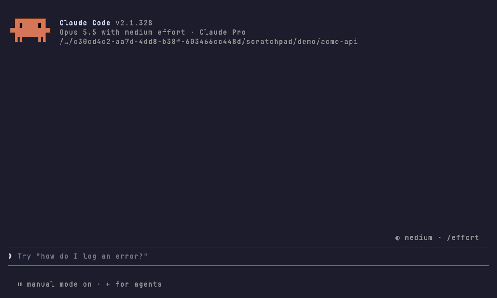
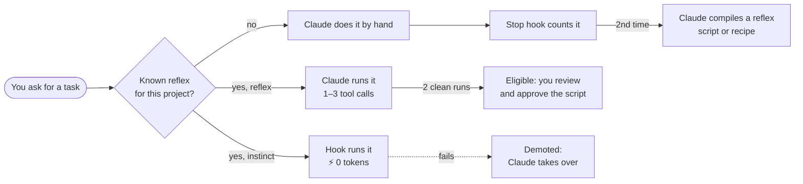

<div align="center">

# 🧠 muscle-memory

**Do a task enough times and Claude stops thinking about it.**

A Claude Code plugin that turns your repeated tasks into reflexes,<br>
and your proven reflexes into instincts that run with **zero tokens**.

[](https://github.com/kabirshah4/muscle-memory/actions/workflows/test.yml)


[Results](#measured-results) · [Install](#install) · [How it works](#how-it-works) · [Commands](#commands) · [Safety](#safety)

</div>

<br>

<p align="center">
  
  <br><sub>A real Claude Code session on Opus. Both requests were learned earlier and are now done instantly, for 0 tokens. The second one takes an input (<code>payments</code>).</sub>
</p>

<picture>
  <source media="(prefers-color-scheme: dark)" srcset="docs/cost-dark.svg">
  
</picture>

## Why

Ask Claude to do the same thing three times and it figures it out from scratch three times: it reads the same config, works out the same flags, and runs the same commands. muscle-memory notices the repetition, saves what Claude worked out as a script, and uses that script from then on. Once the script has proven itself, Claude isn't called at all.

| | By hand | Reflex | Instinct |
|---|:---:|:---:|:---:|
| **Who does it** | Claude, from scratch | Claude runs a saved script | The hook runs it before Claude is called |
| **Tool calls** | 2–7 | 1–3 | **0** |
| **Unlocks after** | — | 2 runs (automatic) | 2 clean runs + **your approval** |

> [!NOTE]
> **Status: experimental (v0.6).** It works end to end, and the latest benchmark blocked every wrong result, but only 1 of 5 tasks qualified for zero-token runs (see [Results](#measured-results)). It has only been tested on a small number of tasks. Issues and feedback welcome.

## Measured results

`bench/run.py` drives real headless `claude -p` sessions through 4 task types on fixture repos: 3 runs by hand, 3 runs as a reflex, an instinct run if the reflex became eligible, and 2 control runs with the plugin off. Condensed transcripts of every run (each tool call truncated to 400 characters, assistant text, and the final result with token usage) are in `bench/raw/`.

> [!NOTE]
> **Latest run:** Haiku sessions (`--model claude-haiku-5-5`), 2026-11-19, 5 task types including a realistic release (version bump, changelog, commit, tag), about $0.26 in total. **No wrong output got through to a zero-token run.** One task (`changelog`) reached zero-token runs, answering in 3s for $0.000.

| Task | By hand | Reflex | Instinct | Control (plugin off) | Why it did or didn't reach instinct |
|---|---:|---:|---:|---:|---|
| changelog | $0.006 | $0.002 | **$0.000** | $0.004 | script's result matched the by-hand runs |
| csv | $0.007 | $0.002 | n/a | $0.006 | one clean run short of the two needed |
| report | $0.007 | $0.005 | n/a | $0.007 | **blocked, correctly**: the script left out the language names (2 of 3 runs wrong) |
| release | $0.007 | $0.007 | n/a | $0.005 | **blocked, correctly**: the script skipped changelog entries (2 of 3 runs wrong) |
| scaffold | $0.006 | $0.007 | n/a | $0.007 | blocked: the output didn't mention the `core` module the by-hand runs did (strict) |

Medians. **What this shows:** a script the model compiles can run cleanly and still be wrong. In an earlier run, before the output check, three zero-token runs produced wrong output. The check compares each script run with the by-hand runs and now stops that. The cost is reach: fewer tasks qualify, and on a cheap model many compiled scripts genuinely aren't good enough. Run-to-run variation is large at this sample size. Reproduce with `python3 bench/run.py [--model ...]`, then `python3 bench/summarize.py`.

## Install

```
/plugin marketplace add kabirshah4/muscle-memory
/plugin install muscle-memory@muscle-memory
```

Requires Claude Code, `python3` 3.10+ (standard library only) and `bash`, on **macOS or Linux**. Windows is untested.

> [!IMPORTANT]
> Install it as a **plugin**, not by copying the skill folder. The hooks do the work: without them, Claude rarely loads the skill on its own.

Then just work normally. There's nothing to configure.

Also works with **Codex** (tested live), and experimentally with Gemini CLI and Cursor: see [other CLIs](docs/reference.md#other-agent-clis).

## How it works



| Phase | What happens | Model cost |
|---|---|---|
| **Discover** | A `Stop` hook counts the successful tool calls in each turn (failed or denied ones don't count). After a turn with 2 or more successful tool calls (`MUSCLE_MEMORY_MIN_CALLS`) on a task it doesn't know, it records the task from your prompt's own words, **without asking Claude**. One-off tasks are hidden from `mm list` until they repeat. | none |
| **Count** | After a turn on a task it already knows, the hook bumps the count itself. | none |
| **Compile** | On the 2nd run, Claude compiles it **automatically, with no approval needed** (it only writes a file): a `.sh`/`.py` script when the commands are the same every time (inputs become args with defaults), or a `.md` recipe of 15 lines or fewer when the task needs judgment. | one turn, once per task |
| **Recall** | A `UserPromptSubmit` hook matches your prompt against reflexes by keyword and adds one line telling Claude to `run` the matching reflex. | reduced |
| **Instinct** | After 2 clean runs whose result **matches what was done by hand** (same files changed, same content, checked mechanically), a script reflex becomes **eligible**. **Only you can approve it**, in your terminal (`mm promote <key>`). After that, prompts with an approved wording or pattern run it with **no model call**. [Details →](docs/how-it-works.md#instincts) | **zero** |
| **Self-heal** | A failed instinct is demoted, and Claude takes over with the error. A reflex that fails twice in a row is disabled until it's fixed. | normal |

### Scoping

Reflexes belong to the project they were learned in (its git root) and only match there. "Deploy the worker" in project B never runs project A's deploy script. Claude saves a reflex with `--global` only when the task is the same everywhere. Project reflexes win ties.

<details>
<summary>Where state lives</summary>

```
~/.claude/muscle-memory/
├── projects/<name>-<hash>/
│   ├── index.json        counts, triggers, use/fail stats
│   └── reflexes/         <key>.sh · <key>.py · <key>.md
└── global/
    ├── index.json
    └── reflexes/
```

</details>

## Commands

**Zero-token shortcut:** type `mm <key> [args]` as your whole prompt (for example `mm deploy-worker staging`). The hook runs that script reflex and shows you the output. Claude is never called, and since you named the reflex yourself, it needs no approval or matching. Any other prompt that starts with "mm" goes to Claude as normal.

To skip reflexes for one prompt, include the phrase **`no reflex`**. To manage them yourself:

```bash
alias mm='python3 "$(ls -d ~/.claude/plugins/cache/muscle-memory/muscle-memory/*/skills/muscle-memory/scripts/mm.py | sort -V | tail -1)"'
```

| Command | Does |
|---|---|
| `mm list` | tasks in this project + global (`--all` for every project) |
| `mm show <key>` | print a reflex |
| `mm run <key> [args]` | execute a reflex and record success/failure |
| `mm promote <key>` | review the script and its wordings, then type `yes` (terminal only) |
| `mm demote <key>` | stop it running without Claude |
| `mm forget <key>` | delete it |

Settings: see [environment variables](docs/reference.md#environment-variables).

## Safety

Reflexes are scripts that Claude writes and runs on your machine. They stay local and are never uploaded. Because instincts run with no model in the loop, they need:

- ✅ 2 clean runs as a reflex first, whose result matched the by-hand runs (same files, same content words), checked mechanically: a script that runs without errors can still be wrong
- ✅ **your explicit approval** in an interactive terminal after seeing the script (`mm promote <key>`), pinned to its sha256 hash. The hash covers that one file only, not other scripts it calls.
- ✅ an exact match: the prompt must use the same words, in the same order, as a wording you approved (filler words like "the" are ignored), be 12 words or fewer, and contain no question mark or negation ("don't", "not", ...). Pattern slots only accept a single plain word (letters, digits and `. _ / : @ + = -`, no `..`), passed as an argument and never through a shell
- ✅ the right project (or an explicit `--global`)

They're demoted on the first failure. Review yours with `mm list` and `mm show` now and then.

> [!WARNING]
> Matching is keyword overlap, not meaning. For reflex hints, a prompt that shares words with a reflex's triggers but means something else could match it (Claude still decides). Instincts only fire on approved wordings. Use `no reflex` or `mm demote <key>` when that happens.

## Limitations

- Requests phrased with entirely different words won't find their reflex.
- Requests with inputs only skip Claude when they follow a learned pattern word for word, and each input is a single plain word. Anything else ("deploy *the branch I was just on*") goes to Claude.
- Tested on macOS with a handful of tasks. Expect rough edges.

## Development

```bash
python3 -m unittest discover -v tests   # 70 end-to-end tests
python3 docs/make_charts.py             # regenerate the README chart from bench/results.csv
```

Sources for every claim above: [docs/reference.md#sources](docs/reference.md#sources).

## License

MIT
