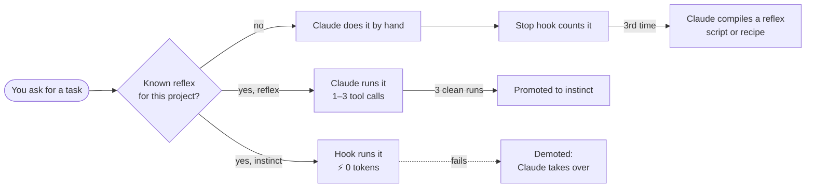
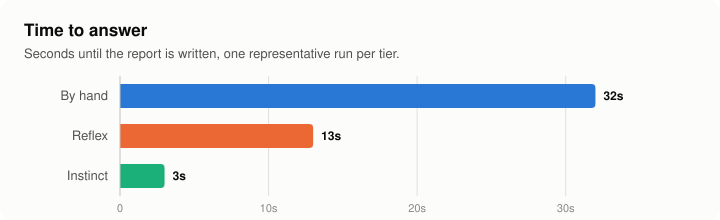

<div align="center">

# 🧠 muscle-memory

**Do a task enough times and Claude stops thinking about it.**

A Claude Code plugin that turns your repeated tasks into reflexes,<br>
and your proven reflexes into instincts that run with **zero tokens**.

[](https://github.com/kabirshah4/muscle-memory/actions/workflows/test.yml)


[Install](#install) · [How it works](#how-it-works) · [Results](#measured-results) · [Commands](#commands) · [Safety](#safety)

</div>

<br>

<picture>
  <source media="(prefers-color-scheme: dark)" srcset="docs/cost-dark.svg">
  
</picture>

## Why

Ask Claude to do the same thing three times and it figures it out from scratch three times: it reads the same config, works out the same flags, and runs the same commands. muscle-memory notices the repetition, saves what Claude worked out as a script, and uses that script from then on. Once the script has proven itself, Claude isn't called at all.

| | By hand | Reflex | Instinct |
|---|:---:|:---:|:---:|
| **Who does it** | Claude, from scratch | Claude runs a saved script | The hook runs it before Claude is called |
| **Tool calls** | 2–7 | 1–3 | **0** |
| **Cost (example)** | $0.10–0.27 | $0.03–0.19 | **$0.00** |
| **Unlocks after** | — | 3 repeats | 3 clean reflex runs |

> [!NOTE]
> **Status: experimental (v0.3).** It works end to end, but it has only been tested on a small number of tasks. Issues and feedback welcome.

## Install

```
/plugin marketplace add kabirshah4/muscle-memory
/plugin install muscle-memory@muscle-memory
```

Requires Claude Code, `python3` 3.10+ (standard library only) and `bash`, on **macOS or Linux**. Windows is untested.

> [!IMPORTANT]
> Install it as a **plugin**, not by copying the skill folder. The hooks do the work: without them, Claude rarely loads the skill on its own.

Then just work normally. There's nothing to configure.

## How it works



| Phase | What happens | Model cost |
|---|---|---|
| **Discover** | A `Stop` hook counts the tool calls in each turn. After a 3+ call turn on a task it doesn't know, it asks Claude whether the task could recur. It asks **at most once per session.** | one short turn, max once per session |
| **Count** | After a turn on a task it already knows, the hook bumps the count itself. | none |
| **Compile** | On the 3rd run, Claude writes a reflex: a `.sh`/`.py` script when the commands are the same every time (inputs become args with defaults), or a `.md` recipe of 15 lines or fewer when the task needs judgment. | one turn, once per task |
| **Recall** | A `UserPromptSubmit` hook matches your prompt against reflexes by keyword and adds one line telling Claude to `run` the matching reflex. | reduced |
| **Instinct** | After 3 successful runs in a row with no args, a script reflex is promoted. On a strong match, the prompt hook runs it, shows you the output and **never calls the model**. | **zero** |
| **Self-heal** | A failed instinct is demoted, and Claude takes over with the error. A reflex that fails twice in a row is disabled until it's fixed. | normal |

### Scoping

Reflexes belong to the project they were learned in (its git root) and only match there. "Deploy the worker" in project B never runs project A's deploy script. Claude saves a reflex with `--global` only when the task is the same everywhere. Project reflexes win ties.

<details>
<summary>Where state lives</summary>

```
~/.claude/muscle-memory/
├── projects/<name>-<hash>/
│   ├── index.json        counts, triggers, use/fail stats
│   └── reflexes/         <key>.sh · <key>.py · <key>.md
└── global/
    ├── index.json
    └── reflexes/
```

</details>

## Measured results

> [!NOTE]
> **One example, not a benchmark.** These are headless `claude -p` sessions running a "write a repo health report" task on a small test repo, with the plugin installed from GitHub. Your numbers will depend on the task and your setup.

<picture>
  <source media="(prefers-color-scheme: dark)" srcset="docs/speed-dark.svg">
  
</picture>

| Run | Tier | What happened | Cost |
|:---:|---|---|---:|
| 1 | By hand | Asked once whether to log the new task | $0.265 |
| 2 | By hand | Counted by the hook, no extra turn | $0.104 |
| 3 | By hand | Threshold reached, reflex compiled | $0.248 |
| 4 | Reflex | Claude ran the script | $0.185 |
| 5 | Reflex | | $0.042 |
| 6 | Reflex | Promoted to instinct | $0.031 |
| 7 | **Instinct** | **Hook ran it, no model call, ~3s** | **$0.000** |

Costs vary a lot from run to run because of prompt caching (the first call in a while pays to write the cache). Rule of thumb: the more exploring a task normally takes, the more a reflex saves. Instinct is where the big difference is, because it removes the model call entirely. It only covers requests that need no task-specific inputs, like "the usual report" or "deploy staging".

## Commands

To skip reflexes for one prompt, include the phrase **`no reflex`**. To manage them yourself:

```bash
alias mm='python3 "$(ls -d ~/.claude/plugins/cache/muscle-memory/muscle-memory/*/skills/muscle-memory/scripts/mm.py | tail -1)"'
```

| Command | Does |
|---|---|
| `mm list` | tasks in this project + global (`--all` for every project) |
| `mm show <key>` | print a reflex |
| `mm run <key> [args]` | execute a reflex and record success/failure |
| `mm promote <key>` | let it run without Claude now |
| `mm demote <key>` | stop it running without Claude |
| `mm forget <key>` | delete it |

<details>
<summary>Environment variables</summary>

| Env var | Default | Meaning |
|---|---|---|
| `MUSCLE_MEMORY_THRESHOLD` | `3` | repeats before compiling |
| `MUSCLE_MEMORY_INSTINCT_AFTER` | `3` | clean no-arg runs before a reflex becomes an instinct |
| `MUSCLE_MEMORY_MIN_CALLS` | `3` | tool calls in a turn before it counts as a task |
| `MUSCLE_MEMORY_ASK` | `1` | set to `0` to never be asked about new tasks (only known tasks are counted) |
| `MUSCLE_MEMORY_DIR` | `~/.claude/muscle-memory` | where state is stored |

</details>

## Safety

Reflexes are scripts that Claude writes and runs on your machine. They stay local and are never uploaded. Because instincts run with no model in the loop, they need:

- ✅ 3 clean runs as a reflex first
- ✅ a strong keyword match (score ≥ 0.75)
- ✅ the right project (or an explicit `--global`)

They're demoted on the first failure. Review yours with `mm list` and `mm show` now and then.

> [!WARNING]
> Matching is keyword overlap, not meaning. A prompt that shares words with a reflex's triggers but means something else could match it. Use `no reflex` or `mm demote <key>` when that happens.

## Limitations

- Requests phrased with entirely different words won't find their reflex.
- Requests with inputs ("deploy *this branch* to *prod*") stay at the reflex tier, because something has to work out the arguments.
- Tested on macOS with a handful of tasks. Expect rough edges.

## Development

```bash
python3 -m unittest discover -v tests   # 14 end-to-end tests
python3 docs/make_charts.py             # regenerate README charts
```

## License

MIT
