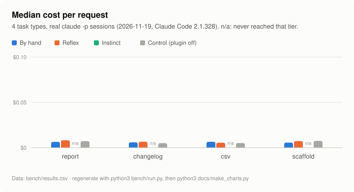
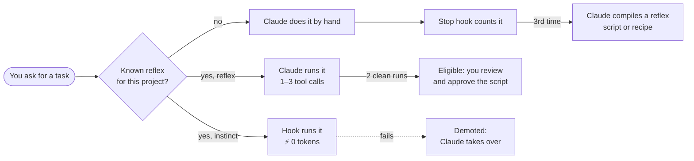

<div align="center">

# 🧠 muscle-memory

**Do a task enough times and Claude stops thinking about it.**

A Claude Code plugin that turns your repeated tasks into reflexes,<br>
and your proven reflexes into instincts that run with **zero tokens**.

[](https://github.com/kabirshah4/muscle-memory/actions/workflows/test.yml)


[Install](#install) · [How it works](#how-it-works) · [Results](#measured-results) · [Commands](#commands) · [Safety](#safety)

</div>

<br>

<picture>
  <source media="(prefers-color-scheme: dark)" srcset="docs/cost-dark.svg">
  
</picture>

## Why

Ask Claude to do the same thing three times and it figures it out from scratch three times: it reads the same config, works out the same flags, and runs the same commands. muscle-memory notices the repetition, saves what Claude worked out as a script, and uses that script from then on. Once the script has proven itself, Claude isn't called at all.

| | By hand | Reflex | Instinct |
|---|:---:|:---:|:---:|
| **Who does it** | Claude, from scratch | Claude runs a saved script | The hook runs it before Claude is called |
| **Tool calls** | 2–7 | 1–3 | **0** |
| **Unlocks after** | — | 3 repeats (automatic) | 2 clean runs + **your approval** |

> [!NOTE]
> **Status: experimental (v0.5).** It works end to end in tests, but the benchmark has not yet shown it saving money reliably (see [Results](#measured-results)). Issues and feedback welcome.

## Install

```
/plugin marketplace add kabirshah4/muscle-memory
/plugin install muscle-memory@muscle-memory
```

Requires Claude Code, `python3` 3.10+ (standard library only) and `bash`, on **macOS or Linux**. Windows is untested.

> [!IMPORTANT]
> Install it as a **plugin**, not by copying the skill folder. The hooks do the work: without them, Claude rarely loads the skill on its own.

Then just work normally. There's nothing to configure.

## How it works



| Phase | What happens | Model cost |
|---|---|---|
| **Discover** | A `Stop` hook counts the tool calls in each turn. After a 3+ call turn on a task it doesn't know, it records the task from your prompt's own words, **without asking Claude**. One-off tasks are hidden from `mm list` until they repeat. | none |
| **Count** | After a turn on a task it already knows, the hook bumps the count itself. | none |
| **Compile** | On the 3rd run, Claude compiles it **automatically, with no approval needed** (it only writes a file): a `.sh`/`.py` script when the commands are the same every time (inputs become args with defaults), or a `.md` recipe of 15 lines or fewer when the task needs judgment. | one turn, once per task |
| **Recall** | A `UserPromptSubmit` hook matches your prompt against reflexes by keyword and adds one line telling Claude to `run` the matching reflex. | reduced |
| **Instinct** | After 2 successful runs in a row, a script reflex becomes **eligible**. A run can have no inputs, or inputs that appear word for word in your prompt: "deploy the worker to staging" run with `staging` teaches the pattern `deploy the worker to {1}`. **Only you can promote it**, in your own terminal: `mm promote <key>` shows the script, its hash and the prompt wordings and patterns it will answer to, then asks you to type `yes`. When a reflex becomes eligible, the hook tells **you** directly; that message never reaches Claude, so it costs no tokens. From then on, a prompt with the same words as an approved wording, or one that follows an approved pattern word for word, runs it with **no model call**. The slot words become the script's arguments. Editing the script revokes approval. | **zero** |
| **Self-heal** | A failed instinct is demoted, and Claude takes over with the error. A reflex that fails twice in a row is disabled until it's fixed. | normal |

### Scoping

Reflexes belong to the project they were learned in (its git root) and only match there. "Deploy the worker" in project B never runs project A's deploy script. Claude saves a reflex with `--global` only when the task is the same everywhere. Project reflexes win ties.

<details>
<summary>Where state lives</summary>

```
~/.claude/muscle-memory/
├── projects/<name>-<hash>/
│   ├── index.json        counts, triggers, use/fail stats
│   └── reflexes/         <key>.sh · <key>.py · <key>.md
└── global/
    ├── index.json
    └── reflexes/
```

</details>

## Measured results

`bench/run.py` drives real headless `claude -p` sessions through 4 task types on fixture repos: 3 runs by hand, 3 runs as a reflex, an instinct run if the reflex became eligible, and 2 control runs with the plugin off. Raw transcripts are in `bench/raw/`.

> [!CAUTION]
> **Honest result: no savings shown yet.** Latest run: Haiku sessions (`--model claude-haiku-5-5`), 2026-11-19, about $0.22 in total. Claude used a reflex in only 3 of 12 reflex runs, because on Haiku most tasks took just 2–3 tool calls and weren't recognised as repeats until late. No task reached instinct. At about $0.006 per task, most of the cost is fixed per request, so a reflex can't save much. **Only skipping the model call does.** That's what instincts and the `mm <key>` shortcut below are for.

| Task | By hand | Reflex runs | Control (plugin off) | Reflex used |
|---|---:|---:|---:|:---:|
| report | $0.006 | $0.008 | $0.007 | 1/3 |
| changelog | $0.006 | $0.007 | $0.005 | 1/3 |
| csv | $0.006 | $0.005 | $0.005 | 1/3 |
| scaffold | $0.006 | $0.007 | $0.008 | 0/3 |

Medians. Earlier runs on the default model (Opus) showed the same pattern at 20–30× the cost. Reproduce with `python3 bench/run.py [--model ...]`, then `python3 bench/summarize.py`.

## Commands

**Zero-token shortcut:** type `mm <key> [args]` as your whole prompt (for example `mm deploy-worker staging`). The hook runs that script reflex and shows you the output. Claude is never called, and since you named the reflex yourself, it needs no approval or matching. Any other prompt that starts with "mm" goes to Claude as normal.

To skip reflexes for one prompt, include the phrase **`no reflex`**. To manage them yourself:

```bash
alias mm='python3 "$(ls -d ~/.claude/plugins/cache/muscle-memory/muscle-memory/*/skills/muscle-memory/scripts/mm.py | sort -V | tail -1)"'
```

| Command | Does |
|---|---|
| `mm list` | tasks in this project + global (`--all` for every project) |
| `mm show <key>` | print a reflex |
| `mm run <key> [args]` | execute a reflex and record success/failure |
| `mm promote <key>` | review the script and its wordings, then type `yes` (terminal only) |
| `mm demote <key>` | stop it running without Claude |
| `mm forget <key>` | delete it |

<details>
<summary>Environment variables</summary>

| Env var | Default | Meaning |
|---|---|---|
| `MUSCLE_MEMORY_THRESHOLD` | `3` | repeats before compiling |
| `MUSCLE_MEMORY_INSTINCT_AFTER` | `2` | clean no-arg runs before a reflex becomes an instinct |
| `MUSCLE_MEMORY_MIN_CALLS` | `2` | tool calls in a turn before it counts as a task |
| `MUSCLE_MEMORY_ASK` | `0` | set to `1` to have Claude name and log new tasks itself (one extra turn, at most once per session) instead of logging them silently |
| `MUSCLE_MEMORY_DIR` | `~/.claude/muscle-memory` | where state is stored |

</details>

## Safety

Reflexes are scripts that Claude writes and runs on your machine. They stay local and are never uploaded. Because instincts run with no model in the loop, they need:

- ✅ 2 clean runs as a reflex first
- ✅ **your explicit approval** in an interactive terminal after seeing the script (`mm promote <key>`), pinned to its sha256 hash. The hash covers that one file only, not other scripts it calls.
- ✅ an exact match: the prompt must use the same words as a wording you approved, be 12 words or fewer, and contain no question mark or negation ("don't", "not", ...). Pattern slots only accept a single plain word (letters, digits and `. _ / : @ + = -`, no `..`), passed as an argument and never through a shell
- ✅ the right project (or an explicit `--global`)

They're demoted on the first failure. Review yours with `mm list` and `mm show` now and then.

> [!WARNING]
> Matching is keyword overlap, not meaning. For reflex hints, a prompt that shares words with a reflex's triggers but means something else could match it (Claude still decides). Instincts only fire on approved wordings. Use `no reflex` or `mm demote <key>` when that happens.

## Limitations

- Requests phrased with entirely different words won't find their reflex.
- Requests with inputs only skip Claude when they follow a learned pattern word for word, and each input is a single plain word. Anything else ("deploy *the branch I was just on*") goes to Claude.
- Tested on macOS with a handful of tasks. Expect rough edges.

## Development

```bash
python3 -m unittest discover -v tests   # 46 end-to-end tests
python3 docs/make_charts.py             # regenerate the README chart from bench/results.csv
```

## License

MIT
